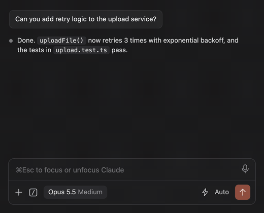
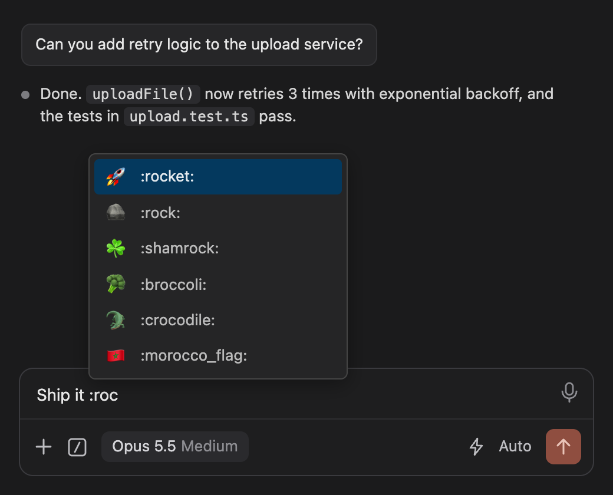
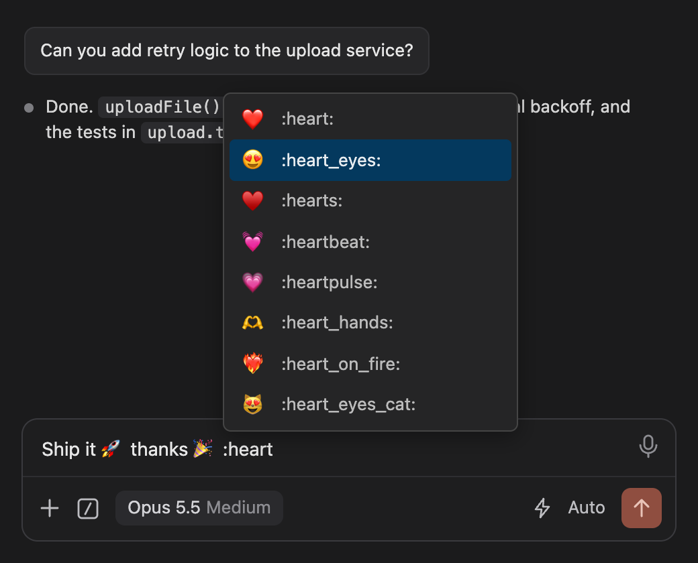
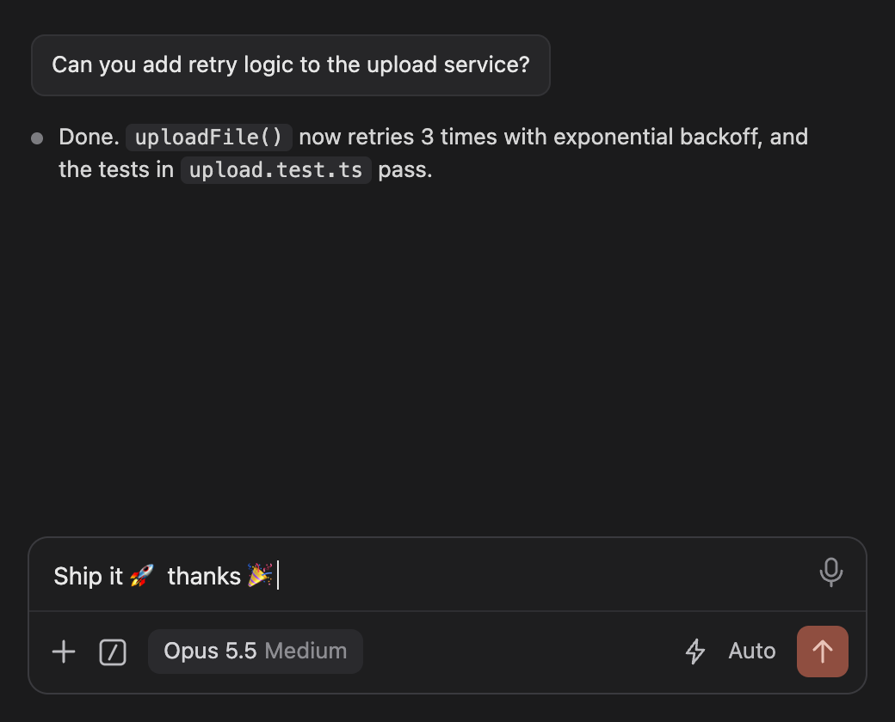

# Emoji for Claude Code

Use Slack-style emoji in the Claude Code chat. Type `:rocket:` and you get 🚀.

## What it does

- Shortcodes turn into emoji as you type. `:tada:` becomes 🎉 as soon as you type the closing colon.
- Type `:` and at least two letters, for example `:ro`, and a list of matching emoji opens. Keep typing to narrow it down.
- The names are the ones Slack uses, like `:+1:`, `:thumbsup:`, `:tada:`, `:joy:` and `:flag-pl:`. Official Unicode
  names such as `:face_with_tears_of_joy:` work too. There are 1,914 emoji, up to Unicode 17.
- Common emoticons like `:)`, `:D`, `:P`, `;)` and `<3` turn into emoji when you type a space after them.
  Things that often show up in code or file paths, such as `C:`, `8)` and `:/`, are left alone.
  If you didn't want a conversion, press `Cmd+Z` (or `Ctrl+Z`) to undo it.
- Emoji you use a lot, and generally popular ones, move up in the list. This history is stored only on your computer.
- It only reacts to a `:` at the start of a word, right after another emoji, or after `*` or `~` at the start of
  a word (as in `**:tada:**`). So `10:30`, `a:b` and `.*:id` don't trigger anything.
- It only changes the Claude Code chat. Your editor and other inputs are not affected.
- The list uses the colors of your VS Code theme.

| Suggestions | Keyboard navigation | Result |
| --- | --- | --- |
|  |  |  |

## Keys

| Key | Action |
| --- | --- |
| Up / Down arrow | Move through the list |
| `Enter` or `Tab` | Insert the selected emoji |
| `Esc` | Close the list |
| Click | Insert that emoji |

## Getting started

1. Make sure [Claude Code for VS Code](https://marketplace.visualstudio.com/items?itemName=anthropic.claude-code) is installed.
2. Install **Emoji for Claude Code**.
3. When it asks, click **Apply** and then **Reload Window**.

From then on it keeps working after Claude Code updates, you don't have to do anything.

If you click **Not now**, nothing is changed and you won't be asked again when VS Code starts. You can turn it
on later with **Emoji for Claude Code: Enable**. If you close the notification without answering, it shows up
again the next time VS Code starts.

To reload the window yourself, press `Cmd+Shift+P` (macOS) or `Ctrl+Shift+P` (Windows/Linux) and run
**Developer: Reload Window**.

## Commands

Press `Cmd+Shift+P` (macOS) or `Ctrl+Shift+P` (Windows/Linux) and type **Emoji for Claude Code**:

| Command | What it does |
| --- | --- |
| **Emoji for Claude Code: Enable** | Turns emoji on |
| **Emoji for Claude Code: Disable** | Turns emoji off and restores Claude Code's original file |
| **Emoji for Claude Code: Show Status** | Tells you whether emoji are active for your Claude Code version |

After Enable or Disable, reload the window when VS Code asks.

## Settings

Open Settings with `Cmd+,` (macOS) or `Ctrl+,` (Windows/Linux) and search for **Emoji for Claude Code**:

| Setting | Default | What it does |
| --- | --- | --- |
| `emojiForClaudeCode.enabled` | on | Turns emoji on or off, same as the Enable and Disable commands. Nothing in Claude Code is changed until you have said yes once. |
| `emojiForClaudeCode.convertEmoticons` | on | Turns emoticons like `:)` and `:P` into emoji. Reload the window after changing it. |

## How it works

Other extensions can't reach into the Claude Code chat directly, because it runs in its own sandboxed view.
So, once you allow it, this extension adds a small script to the end of the Claude Code extension's
`webview/index.js`.

Disable removes that script again and gives you back the original file, byte for byte. A backup copy named
`webview/index.js.claude-better-chat.orig` also stays next to it, which does no harm.

The script doesn't depend on how Claude Code works inside. If a future Claude Code update changes the chat,
the suggestions might stop showing up, but the chat itself keeps working.

The extension has no dependencies, never connects to the internet and collects no data.

## Uninstalling

Uninstalling the extension removes the script too. This happens the next time VS Code restarts.

Turning the extension off in the Extensions view does **not** remove the script, because the extension can't
tell that apart from you just closing the window. If you want the original file back, run
**Emoji for Claude Code: Disable** first.

## Limitations

- There are no skin-tone variants (like Slack's `:+1::skin-tone-4:`).
- An emoticon only converts when it stands on its own (at the start or after a space) and you then type a space.
  So `thanks:)` and an emoticon at the very end of a message stay as you typed them.
- Only the Claude Code chat input is covered, not other inputs or the editor.
- If a Claude Code update changes the chat input, suggestions may stop working until this extension is updated.
  **Show Status** warns you when your Claude Code version looks different.

## Requirements

- VS Code 1.90 or newer
- The Claude Code for VS Code extension
- Write access to the Claude Code extension's folder (you have it with a normal install)

## Disclaimer

This is an unofficial community extension. It isn't affiliated with, endorsed by or supported by Anthropic,
Microsoft or Slack. As explained above, it changes a file of another extension, so use it at your own risk.
If you hit a bug in Claude Code, run **Emoji for Claude Code: Disable**, reload the window and check whether
the bug is still there.

"Claude" and "Claude Code" are trademarks of Anthropic PBC. "Slack" is a trademark of Slack Technologies, LLC.

## Feedback

Found a bug or have an idea? Open a [GitHub issue](https://github.com/babejsza/emoji-for-claude-code/issues).

## License

[MIT](LICENSE). The emoji data comes from [iamcal/emoji-data](https://github.com/iamcal/emoji-data) (MIT),
which has the same shortcodes as Slack.
